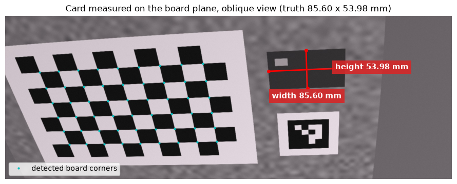
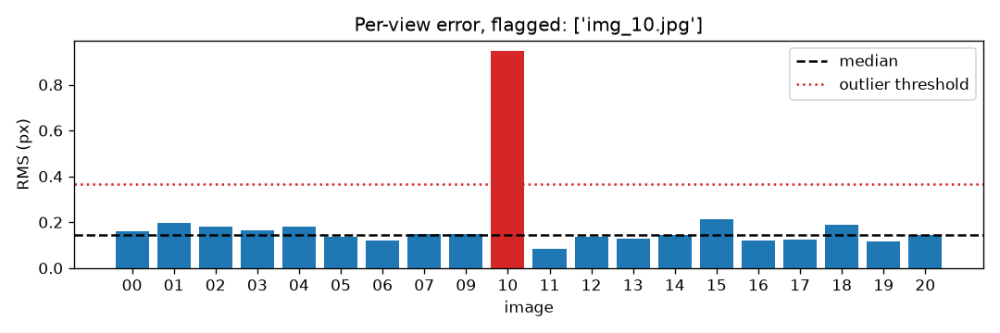
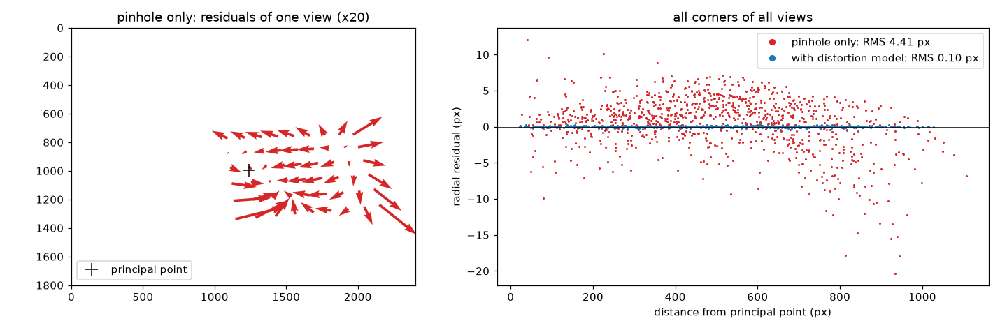
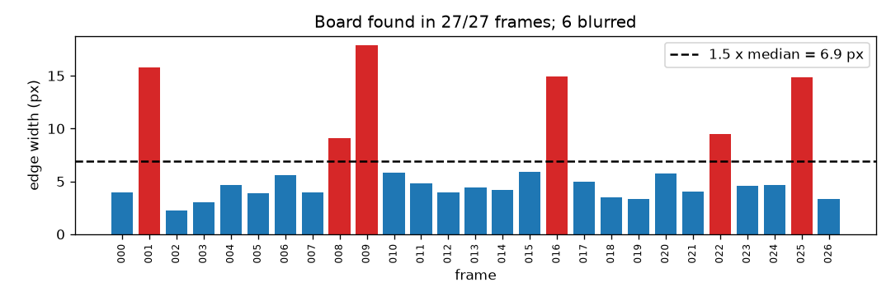
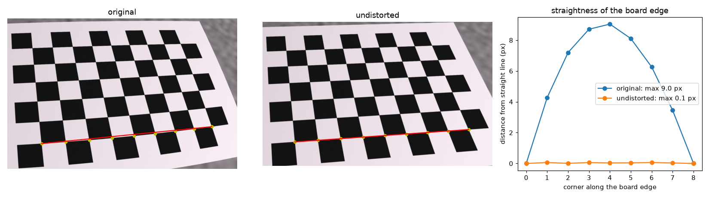

# Measuring in millimetres with a laptop webcam

Calibrating a laptop webcam with a checkerboard shown on a phone screen, validating the calibration against a synthetic camera with known ground truth, and measuring flat objects to **±0.2 mm**.



## Results

| Metric | Target | Achieved |
|---|---|---|
| Reprojection error (RMS) | ≤ 0.5 px | **0.27 px** |
| Hold-out error (unseen views) | ≤ 1.3 × RMS | **1.05 × RMS** |
| Bank card, 85.60 × 53.98 mm | ± 1 mm | **85.68 × 53.81 mm** (+0.08 / −0.17 mm) |
| Undistortion, 1920×1080 | ≥ 20 fps | **≈ 3 ms per frame** with precomputed maps (≈ 10× faster than `cv2.undistort`) |
| Corner detection accuracy (synthetic) | — | **0.06 px** median error |

Everything was first tested on a synthetic test bench, where the true intrinsics, distortion, poses and corner positions are known, and only then applied to the real webcam.

## Key findings

**1. The 640×480 mode is a crop, not a resize.** The webcam's 4:3 modes keep the central 1440×1080 pixels of the sensor and scale them down. Treating 640×480 as a plain resize of the 1080p calibration gives a **24 % error in the focal length**. Modelling the crop correctly predicts the independently calibrated intrinsics within 1.5 %. *([notebook 4](notebooks/04_resolution_modes.ipynb))*

**2. A robust outlier rule found a view taken with a different camera.** Views whose error exceeds 2.5 × the **median** per-view error are flagged. On the test bench this isolates the one image taken after the focus changed, i.e. by a different camera. A rule based on the mean can be pulled up by the bad view itself and miss it. *([notebook 3](notebooks/03_calibration_and_validation.ipynb))*



**3. The distortion model is necessary, and the residuals show why.** Without it the RMS rises from 0.10 to 4.4 px, and the residuals depend systematically on the distance from the image centre: the signature of barrel distortion.



**4. The calibration cannot tell you if the scale is wrong.** Calibrating with a square size that is 3× too large gives exactly the same K, distortion and RMS; only the distances (and therefore every measurement) are 3× off. I nearly made this mistake: a PDF viewer had shrunk a "25 mm" board to 8.25 mm. Only measuring a known object catches it, so I validated with a bank card.

**5. Motion blur that goes in one direction only.** A sharpness metric that measures edge width separately across vertical and horizontal edges, and keeps the worse value, flags motion blur that an averaged score would hide (13.8 px vs 2 px). Six of my 27 webcam frames were blurred; recalibrating without them changes f by only 3 px (0.24 %).



**6. An error budget for measuring off the plane.** The card lies on the screen glass, 0.76 mm above the displayed board. This costs about 0.1 mm. An object 2 cm above the plane would be about 3 mm too large. *([notebook 5](notebooks/05_measurement.ipynb))*

## How it works

```
capture  ->  detect corners  ->  calibrate  ->  validate              ->  measure
1080p PNG    downscaled search   pinhole +      outlier views,            solvePnP gives the plane,
from the     + sub-pixel refine  5-parameter    hold-out error,           pixel -> ray,
webcam       at full resolution  distortion     residual analysis         ray ∩ plane = point in mm
```

- **Detection:** `findChessboardCornersSB`, with the classic detector as fallback, on a downscaled copy for speed, then `cornerSubPix` on the full-resolution image for accuracy.
- **Calibration:** Zhang's method (`cv2.calibrateCamera`). The reprojection errors are recomputed independently with `projectPoints` and checked against OpenCV's.
- **Validation:** an outlier rule based on the median; a hold-out error where every 4th view is left out and only its pose is estimated (`solvePnP`, K fixed); residual plots with and without distortion.
- **Measurement:**
  1. Remove the distortion from the clicked pixels (`undistortPoints`).
  2. Turn each pixel into a ray in the board frame: it starts at the camera centre C = −Rᵀt and has direction Rᵀ(x, y, 1).
  3. Intersect the ray with the board plane Z = 0, written in NumPy.
- **Intrinsics across resolutions:** `scale_intrinsics` (with the half-pixel convention) and `crop_intrinsics` predict K for other camera modes.



## Hardware and setup

| | |
|---|---|
| Camera | laptop webcam, 1920×1080 at 30 fps, fixed focus, Windows Studio Effects off |
| Target | 9×6 checkerboard shown full-screen on a phone (2400×1080, 394.6 ppi): 8.24 mm squares, checked with a ruler (8.25 mm) |
| Data | 27 calibration frames covering the whole image ([coverage](docs/images/coverage.png)), 11 frames in 640×480, 12 measurement photos |

A phone screen is flatter than any printed sheet, and its pattern is pixel-exact. In exchange it needs ≥ 70 % brightness (otherwise the screen's flicker shows up as stripes with the webcam's row-by-row readout), no zoom in the image viewer, and no reflections.

## Repository layout

```
calib/        the library: camera I/O, corner detection, calibration, validation, geometry, YAML I/O
scripts/      capture.py (guided capture), undistort_live.py, measure.py (click → mm)
testbench/    synthetic camera with known ground truth (rendered images, true K, poses, corners)
tests/        pytest suite: every function is checked against the ground truth
notebooks/    the case study, step by step, with results
docs/images/  figures used in this README
calibration.yaml   the webcam calibration (OpenCV FileStorage, readable from Python and C++)
```

## Quick start

```bash
pip install -r requirements.txt
python -m testbench.make_dataset        # render the synthetic test bench once (1–2 min)
pytest                                  # 23 tests against the ground truth
```

With a webcam:

```bash
python scripts/capture.py --out data/webcam/calib_1920x1080 --width 1920 --height 1080
python scripts/undistort_live.py --calib calibration.yaml
python scripts/measure.py data/webcam/apps_1920x1080/<photo>.png --calib calibration.yaml --square 8.24
```

`measure.py` finds the board, estimates its pose, and prints the distance in mm for every pair of points you click.

The notebooks run end to end on the synthetic data. The webcam sections need your own captures in `data/webcam/` (mine are not published because they show my face).

## Tech stack

Python · OpenCV · NumPy · pandas · Matplotlib · pytest · Jupyter

## Author

**Yasser EL BACHIRI** · [yasser.elbachiri@gmail.com](mailto:yasser.elbachiri@gmail.com)
